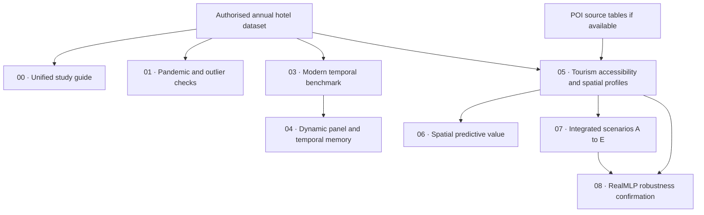

<p align="center">
  
</p>

# Spatio-Temporal Machine Learning for Hotel Labour Productivity

**A reproducible research workflow for spatial accessibility, temporal dynamics, pandemic robustness, and tabular learning in independent hotels in Portugal (2018–2024).**


This repository organises eight research notebooks developed for a manuscript being prepared for ***Knowledge-Based Systems***. It documents the experimental design and preserves the analytical logic while providing a consistent English-language version of the scripts and study guides. **It does not constitute a published paper, a verified reproduction, or a claim of superior model performance.**

## Research questions

How much do hotel structure, regional context, spatial accessibility, and temporal memory contribute to explaining hotel labour productivity? Are predictive comparisons robust to the 2020 disruption, outliers, spatial representation, and random seeds?

The exploratory work studies annual observations from 2018–2024. The dependent variable is `f_labprodct`. Hotel-level geospatial descriptors include access to castles, churches, and beaches and an 800-metre restaurant/café count, subject to the provenance limitations described below.

## Experimental workflow



Notebooks **00, 01, 03 and 04** analyse the annual hotel dataset directly. Notebooks **06, 07 and 08** depend on the spatial outputs generated in **05**. Notebook 08 requires complete `k=5` spatial indicators for its principal experiments.

## Notebooks

| Notebook | Purpose | Primary inputs |
|---|---|---|
| [00 — Unified study guide](notebooks/00_Unified_Study_Guide.ipynb) | End-to-end modelling and interpretation | Annual hotel dataset |
| [01 — Pandemic and temporal robustness](notebooks/01_Pandemic_and_Temporal_Robustness.ipynb) | 2020 policies, outliers, 2023 validation and 2024 audit | Annual hotel dataset |
| [03 — Modern temporal benchmark](notebooks/03_Modern_Temporal_Benchmark.ipynb) | Temporal evaluation, classical and optional modern regressors | Annual hotel dataset |
| [04 — Dynamic panel regression](notebooks/04_Dynamic_Panel_Regression.ipynb) | Lagged productivity, pooled ARX/panel comparisons | Annual hotel dataset |
| [05 — Spatial accessibility and profiles](notebooks/05_Tourism_Accessibility_and_Spatial_Profiles.ipynb) | POI distances, clustering, spatial maps | Annual data and POI tables |
| [06 — Spatial predictive value](notebooks/06_Spatial_Profiles_and_Prediction.ipynb) | Predictive ablations with within-fold clustering | Outputs from 05 |
| [07 — Integrated spatio-temporal benchmark](notebooks/07_Integrated_SpatioTemporal_Benchmark.ipynb) | Matched-sample scenarios A–E | Outputs from 05 |
| [08 — RealMLP stability and confirmation](notebooks/08_RealMLP_Cluster_Confirmation.ipynb) | Multiple seeds, placebo clusters and k sensitivity | Complete `k=5` outputs from 05 |

The original numbering is preserved for notebooks 03–08; notebooks 00 and 01 are supporting studies.

## Quick start

Requirements: Python, JupyterLab and authorised access to the underlying dataset. Install packages in the **same Python environment as the notebook kernel**.

```bash
python -m venv .venv
# Windows PowerShell: .venv\Scripts\Activate.ps1
# macOS / Linux: source .venv/bin/activate
python -m pip install -r requirements-core.txt
# Install selected modelling backends as required:
python -m pip install -r requirements-models.txt
python scripts/validate_notebooks.py
jupyter lab
```

Launch JupyterLab from the **repository root**, not from the `notebooks/` directory. The notebooks use `Path.cwd()` for data discovery and outputs. Put the Excel file and authorised POI tables in that root directory using the original filenames (see [data requirements](data/README.md)). Do not commit them. For Notebook 05, a previously curated subset may be used when supported; files must use the expected schema.

For a faster diagnostic pass, select the notebook's quick profile (such as `PERFIL='verificacao'` or `PERFIL='rapido'`). Full profiles may invoke GPU-intensive or separately licensed models. They must not be treated as installed or executed unless their status logs confirm successful completion.

## Scientific safeguards

- **Temporal separation:** performance should be evaluated using observations from later years than those used for fitting. Avoid fitting imputers, scalers or clusters on the validation fold.
- **Spatial representation:** scenario E's clusters are derived from spatial features; they do **not** constitute an independent information source. Clusters for predictive tasks must be refitted within training folds.
- **2024 is not a blind test:** it was inspected during earlier development. It is therefore a **retrospective audit**, not independent confirmation; 2021–2023 were also explored.
- **Geographic provenance:** POI indicators may describe a spatial snapshot gathered after the target years. Without historical point-in-time POI records, do not present results as strictly feasible contemporaneous forecasts.
- **Non-causal interpretation:** differences in regression error and associations with POIs do not establish that access to attractions causes higher productivity.

See [Reproducibility and validation](docs/REPRODUCIBILITY.md) for details.

## Data availability and privacy

The original data were **not included in the files supplied for repository construction**. No raw hotel records, proprietary Excel workbooks, hotel-level predictions or cached notebook outputs are included in this archive. The `data/` folder provides instructions only; publish source data only with the rights holder's permission. Generated `resultados_*` directories and row-level output files are excluded by `.gitignore`.

## Environment and static checks

- `requirements-core.txt` lists common tooling and packages used across the notebooks.
- `requirements-models.txt` lists common optional modelling libraries; `requirements-experimental.txt` lists research backends with additional availability/licensing considerations.
- `python scripts/validate_notebooks.py` validates notebook structure and compiles Python code cells **without executing the experiments**.
- `python scripts/report_environment.py` reports installed package versions for reproducibility metadata.

These requirements are a **best-effort dependency inventory**, not a lockfile from a fully validated run. Runtime, data access, and model weight downloads vary by hardware/environment.

## Language audit and compatibility

Python function names, internal calls, scientific explanations and remaining user-facing Portuguese messages were reviewed and translated to English. **Historical column names, CSV keys, paths, and some internal variable names are intentionally preserved**, because downstream experiments depend on them. The cleaned notebooks are distributed without saved cell outputs; the review package retaining original outputs is separate. See [Language and schema policy](docs/LANGUAGE_AUDIT.md).

## Citation, credits, and license

Research context: Luís Silvano and collaborators; please consult the manuscript's definitive author list when available. A final paper title, DOI, citation details, and code license have **not yet been supplied or confirmed**. Do not imply journal endorsement or acceptance. Select an explicit license before allowing public code reuse and check dataset/model licenses separately.

---

**Project status:** research software for an article in preparation; results should be cited only after the corresponding manuscript or validated artifact is available.
